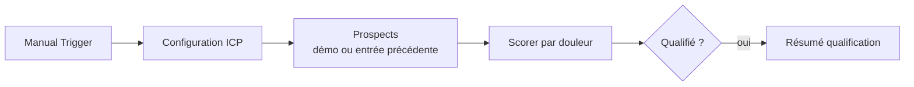

# Qualification de prospects par type de douleur (n8n)

> **EN:** Lightweight n8n workflow that scores B2B agency prospects by the operational pain they express (client reporting, client onboarding, tool integrations) rather than by industry, and returns a tier, the main pain and an outreach angle.
> **EN:** Pure rule-based scoring in a Code node: no LLM call, no external API. Runs on 5 built-in fictional prospects in demo mode.
> **EN:** Weights, threshold and keyword lists are editable.

**FR :** Workflow n8n très léger qui note des prospects d'agences selon la douleur opérationnelle qu'ils expriment (reporting client, onboarding client, outils non connectés) plutôt que selon leur secteur, et renvoie un score, un tier, la douleur principale et un angle d'approche.

## Problème → Solution → Pour qui

- **Problème :** qualifier une liste de prospects par secteur donne des cibles larges et peu actionnables.
- **Solution :** un score par signaux textuels (bio, post, site) pondérés par douleur, plus des bonus de structure (taille, portefeuille, décideur, rapports récurrents).
- **Pour qui :** prestataires d'automatisation qui prospectent des agences marketing. Adaptable à une autre cible en modifiant les trois listes de signaux et leurs poids dans le nœud *Scorer par douleur*.

## Résultat

Sortie réelle du nœud de scoring, obtenue en exécutant localement son code sur les 5 prospects fictifs du mode démo (poids et seuil par défaut) — **données de démonstration** :

| Prospect (fictif) | Score | Tier | Douleur principale | Signaux relevés |
|---|---|---|---|---|
| Pulse Social | 100 | A | reporting | reporting, onboarding, notion + structure |
| Studio Alto — SEO & contenu | 95 | A | reporting | reporting, copier-coller + structure |
| Fullstack Com | 78 | A | integrations | onboarding, crm, slack, sheets + structure |
| Ads Only FR | 33 | C (non qualifié) | reporting* | aucun signal de douleur ; bonus de structure seulement |
| SM Conseil | 7 | C (non qualifié) | reporting* | aucun signal ; décideur seulement |

\* Quand aucun signal n'est trouvé, la douleur principale affichée est « reporting » par défaut (égalité à zéro) : à ignorer pour les prospects non qualifiés.

Le workflow renvoie aussi `icp_angle`, `icp_message_hook` (accroche de message) et un résumé (total, qualifiés, nombre de tier A, top 5).

<!-- TODO capture: onglet de sortie du nœud « Résumé qualification » dans n8n -->

## Comment le score est calculé

1. **Signaux de douleur** : pour chacune des trois douleurs, le nœud compte les expressions trouvées (sans accents ni casse) dans le texte du prospect (société, rôle, nom, bio LinkedIn, dernier post, extrait de site, notes, type d'agence). Points = `min(poids, nb_signaux × ceil(poids / 2))`. Poids par défaut : reporting 45, onboarding 35, intégrations 20.
2. **Bonus de structure** (indépendants du secteur) : taille d'équipe 5–60 = +8 ; au moins 8 clients = +10 ; décideur = +7 ; rapports récurrents confirmés = +12 ; type d'agence renseigné autre que « ecommerce » ou « solopreneur » = +3.
3. **Plafond** : le score est limité à 100.
4. **Tiers** : A si score ≥ 75 ; B si score ≥ `min_score` (55 par défaut) ; C sinon. Seuls les prospects avec `icp_qualified = oui` (tiers A et B) passent le filtre.

« Solopreneur exclu » signifie seulement que ce type d'agence ne reçoit pas le bonus de +3 : il n'y a pas d'exclusion explicite ; un solopreneur reste non qualifié parce qu'il cumule peu de signaux et de bonus.

## Architecture

## Prérequis

- n8n (version minimale non vérifiée) ; aucun credential, aucune API.
- Coût : aucun.

## Installation

1. n8n → **Import from file** → `icp-qualify-douleur-v1.json`.
2. Ouvrir **⚙️ Configuration ICP** : `demo_mode = true` pour l'essai.
3. Cliquer sur **Execute workflow**.
4. Lire la sortie du nœud *Scorer par douleur* (5 lignes) puis *Résumé qualification*.
5. Pour vos données : mettre `demo_mode = false` ; le nœud *Prospects* renvoie alors les éléments reçus du nœud précédent (à ajouter entre le déclencheur et ce nœud : Notion, Google Sheets, export CSV…). Champs reconnus : `name`, `role`, `company`, `agency_type`, `team_size`, `client_count`, `decision_maker` (`oui`/`non`), `recurring_reports` (`oui`/`non`), `linkedin_bio`, `recent_post`, `website_snippet`, `notes`.

## Configuration

| Paramètre | Défaut | Rôle | Nœud |
|---|---|---|---|
| `min_score` | 55 | seuil de qualification (tier B) | ⚙️ Configuration ICP |
| `weight_reporting` / `weight_onboarding` / `weight_integrations` | 45 / 35 / 20 | poids maximum par douleur | ⚙️ Configuration ICP |
| `demo_mode` | true | true = 5 prospects fictifs ; false = entrée du nœud précédent | ⚙️ Configuration ICP |
| `niche_label` | Ops agence — douleur reporting/onboarding | libellé repris dans le résumé | ⚙️ Configuration ICP |
| Listes de signaux | voir le code | mots-clés par douleur | Scorer par douleur |

Aucun placeholder d'identifiant : le workflow ne contient aucun secret.

## Statut et limites

- **Statut : démo.** Sortie vérifiée localement sur les prospects fictifs ; non testé sur une liste réelle.
- Scoring par sous-chaînes de mots-clés français : peu fiable sur des textes courts ou en anglais.
- Le paramètre `cta_keyword` est présent dans la configuration mais n'est pas utilisé : le mot-clé `DEMO` est écrit en dur dans `icp_cta` et dans l'accroche `icp_message_hook`, qui mentionne un « Loom » à envoyer (à adapter à votre propre démarche).
- Les noms des prospects de démonstration sont inventés.

## Licence

MIT, voir [LICENSE](LICENSE).
